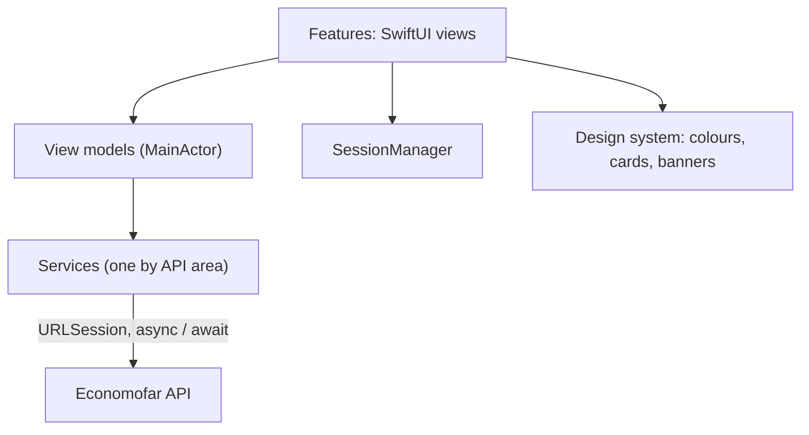

Economofar
==========


An iPhone app that scans shop receipts and shows where the money goes: budgets, a history that can be searched and eighteen analysis screens of the spending. The interface is in French.

The server is in the folder economorfar_api next to this one.

What it does
------------

- Scan a receipt with the camera or pick a photo, wait for the analysis, then check and correct what was read before saving.
- History of the receipts with search, filters (dates, category, payment method, amount) and grouping by month. Each receipt can be edited line by line, duplicated, exported to PDF or CSV, given a note, a warranty date and a business label.
- Dashboard: month so far, budget left, last receipts, status of the last scan, insights.
- Budgets: a monthly budget, a budget for each category with the progress day by day.
- Analyses tab, eighteen screens: unusual purchases, spending rhythm, shops, price of each article, regular purchases, month against month, year review, trends and profile of each category, small purchases, warranties, payment methods, business expenses, needs / wants / savings, budgets day by day, spending events, ticket quality and suggested categories.
- Notifications, profile, password, language and currency, help and support.

How it is built
---------------



- SwiftUI with NavigationStack and MVVM. Each screen has a view and, when it loads data, a view model that is isolated to the main actor. The view models of the analyses ignore answers that arrive late.
- One small service by area of the API. The services of the analyses and of the events go through APIClient, a few older screens call URLSession directly.
- The session (token and current user) lives in Core/Session.
- A small design system (colours, typography, cards, banners) shared by all the screens, so that the analyses look the same.
- The texts are in Localizable.strings and in the views.

Folders
-------

```
economofar
    App           entry point
    Core          design system, components, session, helpers
    Data          models, storage
    Features      one folder by area: Auth, Dashboard, Scanner, History, Analytics, Settings...
    Services      one folder by API area
    Resources     Localizable.strings
```

Run it
------

You need Xcode 26 or later (the app targets iOS 26).

1. Start the server and its demo data. With Docker installed, one command in the folder economorfar_api does it: docker compose up --build. The README of economorfar_api has the details.
2. Open the Xcode project and run the app on a simulator.
3. Sign in with the demo account.

| E-mail | Password |
| --- | --- |
| demo@economofar.app | Demo2026Pass |

The app calls the server at http://localhost:8080, which works on the simulator. On a real iPhone, replace localhost:8080 with the local address of your computer (search the project for localhost: the address is written in several services and screens) and allow the local network when the phone asks.

Status
------

The analyses screens are checked against their own server tests, but the app has no UI tests yet.

Security
--------

- The sign-in token is kept in the iOS Keychain, not in UserDefaults.
- The token is sent only to the server address of the app, never to another host. The images of the receipts are loaded with it.
- The sign-up and the password change show the rules while you type (8 characters, a letter and a digit, not a common password, not your e-mail). The server checks them again and stays the one that decides.

Roadmap
-------

- One place for the server address, set by a build setting.
- Lower the deployment target below iOS 26 to reach more phones.
- A real Face ID lock: the setting exists in the app, the lock itself is not connected yet.
- UI tests and snapshot tests of the main screens.
- Screenshots and a short video.

Author
------

Mahmoud Mansouri
